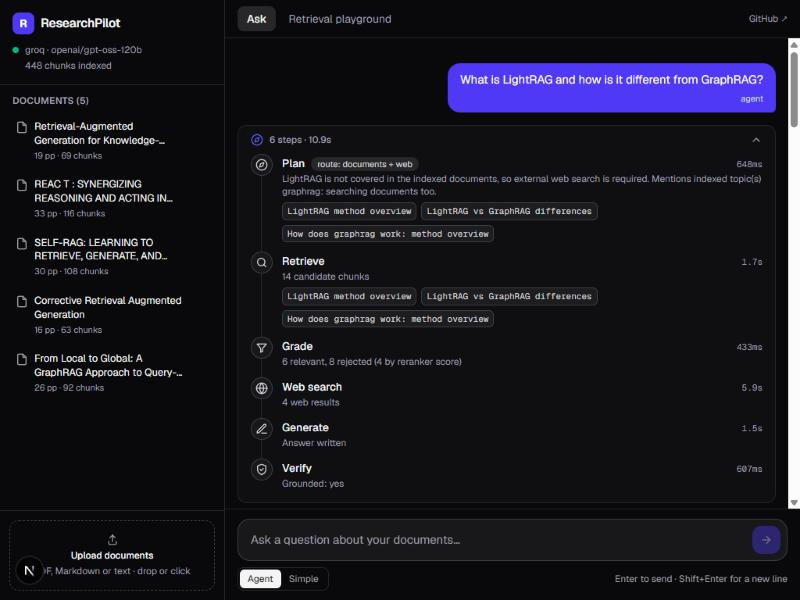
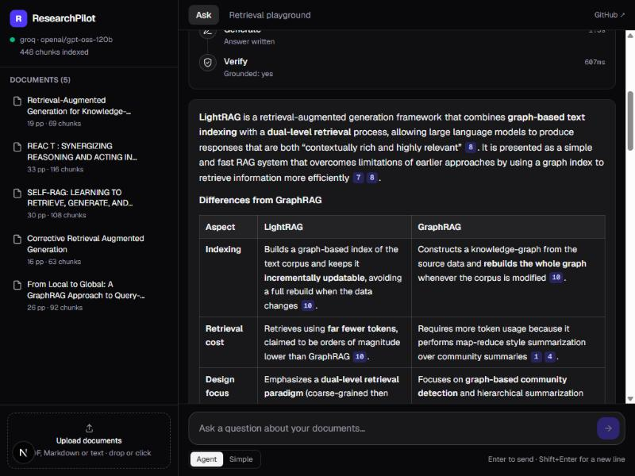
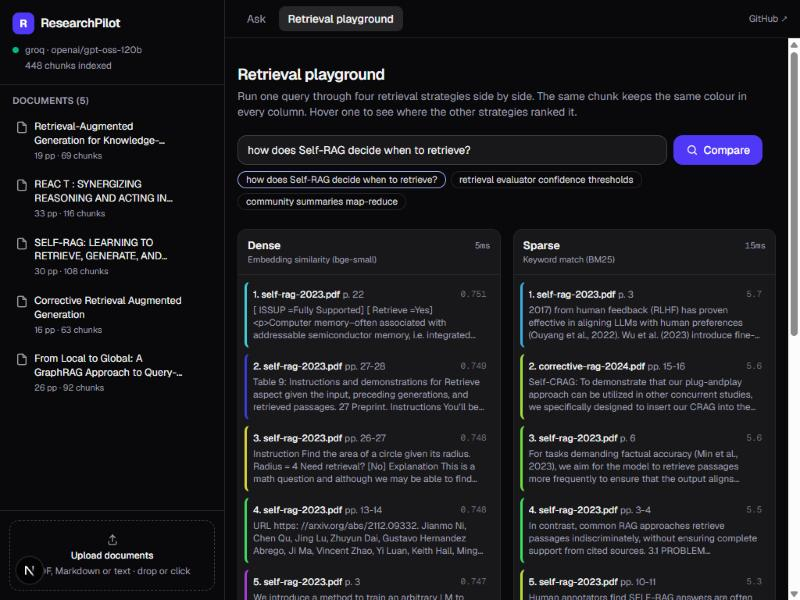

# ResearchPilot

An agentic research assistant over your documents: it plans searches, grades what it
finds, rewrites queries or falls back to the web when the documents fall short, and checks
its own answer against the sources. Hybrid retrieval, cross-encoder reranking, contextual
chunking, and answers with checkable citations. Runs for $0 (free LLM tier + local CPU models).

> Status: **Steps 1-3 of 5 done** (retrieval core, agent, web UI). Evaluation dashboard
> and deployment are next.



| Answer with clickable citations (paper + web sources) | Retrieval playground: 4 strategies side by side |
|---|---|
|  |  |

## Web UI (Next.js 16 + Tailwind 4)

- **Ask**: watch the agent work step by step (plan, retrieve, grade, rewrite, web search,
  generate, verify) with timings, queries and routing decisions; the answer streams in with
  `[n]` citation chips that jump to the source passage; a groundedness badge lists any
  unsupported claims. Toggle **Agent / Simple** to compare against single-pass RAG.
- **Retrieval playground**: one query through dense, BM25, hybrid and hybrid+rerank side by
  side; the same chunk keeps the same colour in every column, so you can see reranking at work.
- **Documents**: upload PDF/Markdown/text (drag and drop), see page/chunk counts, remove documents.
- Streams `POST /ask` Server-Sent Events with `fetch` + a small parser (EventSource is GET-only).
- Responsive (drawer sidebar on phones), light and dark mode.

## The agent (LangGraph)

```
            ┌──────────── route = web ─────────────┐
            │                                      ▼
question ─► plan ─► retrieve ─► grade ──────────► web_search ─► generate ─► verify ─► answer
                       ▲          │  ≥2 relevant &     ▲            ▲
                       │          │  route = both ─────┘            │
                       │          ├── ≥2 relevant ──────────────────┘
                       └─ rewrite ◄┘  too few relevant (1 retry), then web_search
```

| Node | What it does | Model |
|---|---|---|
| **plan** | Sees the indexed titles; routes to `docs` / `both` / `web`; splits comparisons into 2-3 sub-queries | gpt-oss-20b |
| **retrieve** | Hybrid search + rerank per sub-query, merged and de-duplicated | local |
| **grade** | Drops chunks with reranker score < -3, then an LLM grades the rest **per sub-query** (in parallel) | gpt-oss-20b |
| **rewrite** | Nothing relevant? Rephrase with synonyms/paper terminology and retry once | gpt-oss-20b |
| **web_search** | DuckDuckGo metasearch (no key) with backend fallback | — |
| **generate** | Streams an answer citing `[n]` sources, documents preferred over web snippets | gpt-oss-120b |
| **verify** | Groundedness check: `yes` / `partial` / `no` + unsupported claims | gpt-oss-20b |

Ideas taken from the papers in the demo corpus: query decomposition, retrieval evaluation and
web fallback ([Corrective RAG](https://arxiv.org/abs/2401.15884)), and critiquing the output
against its evidence ([Self-RAG](https://arxiv.org/abs/2310.11511)).

### Things learned building it

- **Grade against the sub-query, not the whole question.** For *"What is LightRAG and how
  does it differ from GraphRAG?"*, both gpt-oss models rejected every GraphRAG passage
  ("no LightRAG info, so none relevant"), whatever the prompt said. Grading each passage
  against the sub-query that retrieved it fixed it.
- **Don't let the planner skip your own documents.** The planner sent that question
  straight to the web. A guard now forces `both` when the question names a term from an
  indexed title.
- **Free web search is flaky**, so backends are tried in turn and a failure never breaks
  the answer.
- **Reasoning models need token headroom.** gpt-oss spends tokens thinking first, so short
  JSON replies get extra `max_tokens` and `reasoning_effort: low`.
- **The UI found a race condition the CLI never could.** The page requests `/health` and
  `/documents` at the same moment; FastAPI runs both in its thread pool, both lazily created
  the vector store, and embedded Qdrant (one client per folder) crashed the second one. The
  browser reported it as a CORS error, because a 500 response has no CORS headers. Fix: create
  singletons under a lock, warm them up at startup, and serialize the Qdrant client calls.
  Verified with 12 concurrent requests.

## Retrieval core

```
PDF/MD/TXT ─► load (per page) ─► chunk (sentence-aware, overlap, page numbers)
          ─► contextualize (LLM doc summary prepended to each chunk)
          ─► embed: dense (bge-small) + sparse (BM25) ─► Qdrant (embedded)

query ─► dense + BM25 search ─► Reciprocal Rank Fusion ─► cross-encoder rerank ─► top chunks
```

| Piece | Choice | Runs where |
|---|---|---|
| LLM | Groq (`gpt-oss-120b` answers, `gpt-oss-20b` planning/grading) / Gemini / Ollama, OpenAI-compatible | free API tier or local |
| Agent | LangGraph state machine, custom stream events | local |
| Web search | `ddgs` metasearch | free, no key |
| Dense embeddings | `BAAI/bge-small-en-v1.5` via fastembed | local CPU |
| Sparse | `Qdrant/bm25` + Qdrant IDF modifier | local CPU |
| Fusion | Qdrant Query API, RRF | local |
| Reranker | `ms-marco-MiniLM-L-6-v2` cross-encoder | local CPU |
| API | FastAPI + Server-Sent Events | local |

Typical latency on a laptop CPU: ~5 s for the agent (plan 0.7 s, retrieve 2 s, grade 0.6 s,
generate 0.8 s, verify 0.6 s), ~2 s for the single-pass pipeline.

## Setup (Windows)

```powershell
# from backend/
python -m venv $env:USERPROFILE\.venvs\researchpilot
& $env:USERPROFILE\.venvs\researchpilot\Scripts\Activate.ps1
pip install -r requirements.txt
copy .env.example .env   # then paste your free GROQ_API_KEY into .env
```

## Use

```powershell
python -m app.cli samples                    # download 5 RAG/agent papers from arXiv
python -m app.cli ingest $env:USERPROFILE\.researchpilot\samples   # index them
python -m app.cli search "how does Self-RAG decide when to retrieve?" --compare
python -m app.cli ask "How do Self-RAG and Corrective RAG handle bad retrieved documents?"
python -m app.cli ask "What is LightRAG and how is it different from GraphRAG?"   # docs + web
python -m app.cli ask "..." --simple         # single-pass pipeline, no agent

uvicorn app.api:app --reload --port 8000     # API docs at http://localhost:8000/docs
```

Then the web UI, in a second terminal (needs Node.js 20.9+):

```powershell
cd frontend
npm install
npm run dev                                  # http://localhost:3000
```

Embedded Qdrant allows one process at a time, so stop the API server before using the CLI.
Runtime data (index, model cache, uploads, samples) lives in `~/.researchpilot` (override with
`DATA_DIR` in `.env`); a short path avoids the Windows 260-character path limit.

## API

| Method | Path | What |
|---|---|---|
| GET | `/health` | index size, LLM provider/model status |
| GET | `/documents` | indexed documents |
| POST | `/documents` | upload + index files (multipart `files`) |
| DELETE | `/documents/{doc_id}` | remove a document |
| POST | `/search` | retrieval only; `mode`: `dense`, `sparse`, `hybrid`, `hybrid_rerank` |
| POST | `/ask` | SSE stream; body `{"question", "agent": true}` |

`/ask` events (data is always a JSON object):

| Event | Data |
|---|---|
| `step` | `stage` (plan, retrieve, grade, rewrite, web_search, generate, verify), `status` (running/done/error), `detail`, `ms`, sometimes `queries` |
| `sources` | `sources`: numbered chunks / web results (`rank`, `title`, `source`, `pages`, `text`, `scores`, `url`) |
| `token` | `text`: next piece of the answer |
| `check` | `grounded` (yes/partial/no/unknown), `unsupported` claims |
| `done` | `answer`, `cited` source numbers |
| `error` | `message` |

## Roadmap

1. ~~Core: ingest, hybrid search, rerank, cited answers~~
2. ~~LangGraph agent: query decomposition, relevance grading, query rewrite, web-search fallback, groundedness check~~
3. ~~Next.js UI: live agent steps, citations, retrieval playground~~
4. Evaluation: synthetic test set, recall@k / MRR, faithfulness, answer relevance
5. Deploy: Vercel + Hugging Face Spaces
